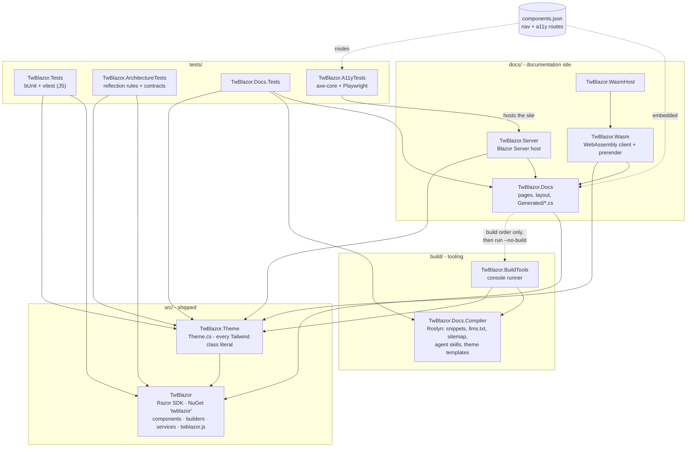
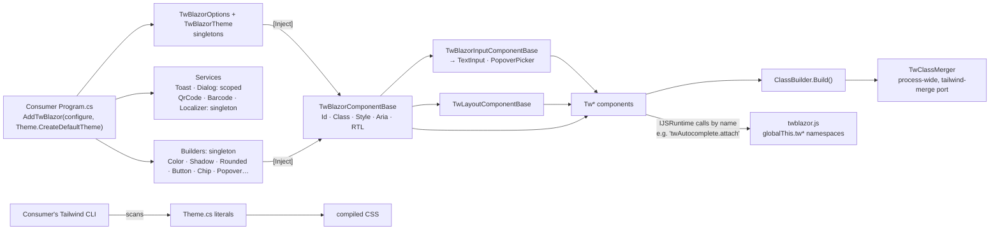
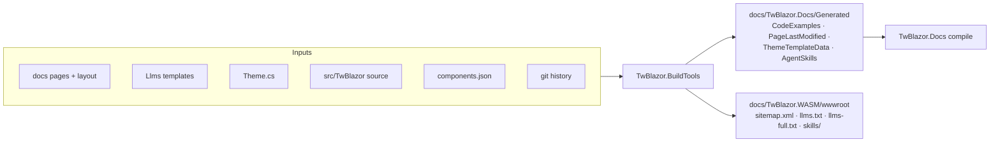

# Architecture

How TwBlazor is put together: the projects in the solution, how a component gets its classes at runtime, and how
the docs site and tests are built around the library. For build commands and contribution rules see
[AGENTS.md](AGENTS.md) and [CONTRIBUTING.md](CONTRIBUTING.md).

## Projects

`TwBlazor` is the only project that ships as a package. Everything else points inward at it.

| Project | Role |
|---|---|
| `src/TwBlazor` | The component library. Depends only on `Microsoft.AspNetCore.Components.Web`. |
| `src/TwBlazor.Theme` | The default `Theme.cs`. Not packaged; consumers copy it (or generate one with the docs theme builder). |
| `build/TwBlazor.Docs.Compiler` | Roslyn-based extractors and generators used only at docs build time. |
| `build/TwBlazor.BuildTools` | Console app that runs the compiler and writes the generated docs files. |
| `docs/TwBlazor.Docs` | Docs pages as a Razor class library, shared by both hosts. |
| `docs/TwBlazor.Server`, `docs/TwBlazor.WASM`, `docs/TwBlazor.WasmHost` | The same docs site hosted as Blazor Server and as WebAssembly. |
| `tests/*` | Unit, architecture, docs and accessibility tests. |

Rules worth keeping:

- Nothing in `build/` may be referenced by `src/` or by the docs hosts. The Roslyn packages it uses would otherwise
  end up in the WebAssembly download.
- `components.json` is the single list of components. It drives the docs navigation, the component catalogue and
  the routes the accessibility tests scan.

## Runtime

### Theming

Tailwind only generates CSS for class names it can find written out in full in source files, and it cannot scan
a compiled DLL. So the library ships no CSS. Every class a component uses is a string literal in `Theme.cs`, held
in a typed theme record per component (`src/TwBlazor/Configuration/Components/Tw*Theme.cs`). The consuming app
keeps `Theme.cs` in its own project and points its Tailwind build at it.

`AddTwBlazor` accepts a theme factory. On hot reload, `TwBlazorUpdateHandler` and `ThemeUpdateHandler` call it
again and swap `TwBlazorOptions.Theme`, so theme edits show up without a restart.

### Components

- `TwBlazorComponentBase` gives every component `Id`, `Class`, `Style`, unmatched attributes, ARIA labels,
  `Shadow`, `Rounded` and right-to-left handling (`ToLogicalKey`, mirrored icons).
- Input components build on `TwBlazorInputComponentBase` (EditContext binding and validation), with
  `TwBlazorTextInputComponentBase` and `TwPopoverPickerComponentBase` for text fields and popover pickers.
- Builders (`src/TwBlazor/Builders`) turn a component's parameters and the theme into class strings. They hold no
  state and only read `TwBlazorOptions`, so they are singletons.
- `ClassBuilder.Build()` passes the result through `TwClassMerger`, so a consumer's `Class="px-2"` replaces the
  theme's `px-4` instead of both being applied.

### JavaScript

`src/TwBlazor/wwwroot/js/twblazor.js` is loaded by a `<script>` tag and defines one `globalThis.tw*` object per
feature (`twPicker`, `twAutocomplete`, `twFocus`, ...). Components call these by name through `IJSRuntime`. JS unit
tests live in `tests/TwBlazor.Tests/js` and run with `npm test`.

### Known constraints

- **Process-wide state.** `TwClassMerger.Current`, `TwBlazorUpdateHandler` and `Theme.DefaultTheme` are statics.
  Hot reload needs them, and `ClassBuilder` (a public struct used in hundreds of places) has no access to DI. The
  last `AddTwBlazor` call in a process wins, so tests that change class-merge options must restore the defaults
  (see `ServiceCollectionExtensionsTests`).
- **One JS file.** Every page loads all of `twblazor.js`, and a renamed JS function only fails at runtime. Moving
  to per-component ES modules loaded with `import` would fix both, but it changes how apps set the library up, so
  it belongs in a major version.

## Docs build

`TwBlazor.Docs.csproj` runs BuildTools in a `BeforeBuild` target:

- BuildTools is a build-order-only `ProjectReference`, so the main build compiles it first and the target runs it
  with `dotnet run --no-build`. A second, nested build would race the main one for the same output files.
- The target lists its inputs and outputs, so it is skipped when nothing has changed. The git index stands in for
  git history. Pass `-p:ForceDocsGeneration=true` to run it anyway.
- It is skipped, along with the BuildTools reference, when `CF_PAGES=1` (Cloudflare Pages builds).

## Tests

| Project | What it covers |
|---|---|
| `TwBlazor.Tests` | bUnit tests for components, builders, services, localisation and utilities, plus vitest for `twblazor.js`. |
| `TwBlazor.ArchitectureTests` | Reflection rules over the public API (namespaces, naming, parameter contracts). Exceptions are listed exactly, so a list that goes stale fails the test. |
| `TwBlazor.Docs.Tests` | Docs pages, generated files and the build compiler. |
| `TwBlazor.A11yTests` | Starts the Server docs site and runs axe-core through Playwright on every route in `components.json`. Opt-in on PRs. |

CI (`.github/workflows`) runs the build, the first three test projects, the header check, SonarCloud and a
vulnerability scan on every PR to `develop`.
