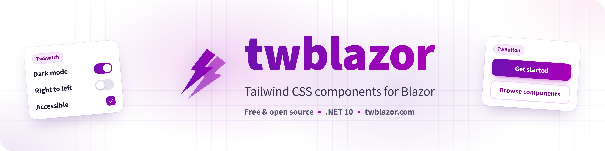
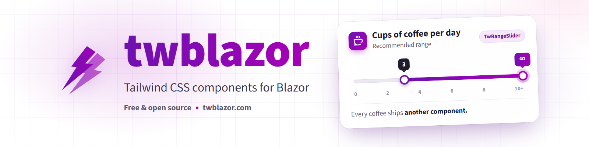

<p align="center">
  <a href="https://twblazor.com/" target="_blank">
    
  </a>
</p>
<p align="center">

[](https://sonarcloud.io/summary/new_code?id=twblazor_twblazor)
[](https://sonarcloud.io/summary/new_code?id=twblazor_twblazor)
[](https://sonarcloud.io/summary/new_code?id=twblazor_twblazor)
[](https://sonarcloud.io/summary/new_code?id=twblazor_twblazor)
[](https://sonarcloud.io/summary/new_code?id=twblazor_twblazor)
[](https://sonarcloud.io/summary/new_code?id=twblazor_twblazor)
[](https://sonarcloud.io/summary/new_code?id=twblazor_twblazor)
[](https://sonarcloud.io/summary/new_code?id=twblazor_twblazor)
[](https://github.com/TwBlazor/twblazor/blob/develop/LICENSE.txt)
[](https://github.com/TwBlazor/twblazor/stargazers)
[](https://github.com/TwBlazor/twblazor/graphs/contributors)
[](https://github.com/TwBlazor/twblazor/discussions)
[](https://www.nuget.org/packages/twblazor)
[](https://www.nuget.org/packages/twblazor)

</p>


<p align="center">
    <a href="https://twblazor.github.io/twblazor/" target="_blank">API Documentation (docfx)</a> &bullet; <a href="https://twblazor.com/" target="_blank">Component Documentation (twblazor.com)</a> &bullet; <a href="https://twblazor.com/get-started" target="_blank">Get Started</a> &bullet; <a href="https://twblazor.com/ai-agents" target="_blank">AI Agents &amp; Skills</a> &bullet; <a href="https://buymeacoffee.com/twblazor" target="_blank">Support development 💜</a>
</p>

## Contents

- [Why twblazor?](#why-twblazor)
- [AI agent skills](#ai-agent-skills)
- [Setup](#setup)
- [Class merging](#class-merging)
- [Localization](#localization)
- [Supported .NET Versions](#supported-net-versions)
- [Dependencies](#dependencies)

## Why twblazor?

- Every component is styled with plain Tailwind CSS classes, so there is no built-in CSS to fight when you want something to look different.
- All styles live in one typed theme file. Change a color, spacing or radius there without digging through component internals.
- See your changes straight away with Tailwind and hot reload.
- Built-in class merging: a `Class` you pass to a component replaces the theme's conflicting utility instead of both reaching the element.
- Accessibility comes first, with ARIA attributes and keyboard navigation built into the components.
- Open source under the MIT license, free for personal and commercial projects.
- Actively maintained, with new components, accessibility fixes and documentation landing regularly.
- Contributions, issues and feedback are welcome from everyone using it.

Using twblazor in your own project? Share it [here](https://github.com/TwBlazor/twblazor/discussions/81). We would love to see what you're building!

## AI agent skills

Using Claude Code or another AI coding agent? twblazor publishes four skills that teach it to set up, theme, localize and build with twblazor using the real components and parameters, instead of guessing or borrowing another library's API:

- `twblazor-setup`: adds twblazor to a Blazor Server or WebAssembly app.
- `twblazor-theming`: creates and changes your `Theme.cs` through the Theme builder.
- `twblazor-components`: writes markup using only the parameters each component has.
- `twblazor-localization`: translations, date and time formats and right to left layouts.

A skill is a folder the agent reads only when a task needs it. The commands below download all four as one zip and extract them into `.claude/skills`, the folder Claude Code loads skills from. Run them from your project's root folder (the one holding your `.sln` or `.csproj`), then start a new Claude Code session.

macOS and Linux:

```bash
# Download every twblazor skill as one zip
curl -L -o twblazor-skills.zip https://twblazor.com/skills/twblazor-skills.zip

# Extract it into .claude/skills, creating the folder if needed and replacing older copies
mkdir -p .claude/skills
unzip -o twblazor-skills.zip -d .claude/skills

# Delete the downloaded zip
rm twblazor-skills.zip
```

Windows PowerShell:

```pwsh
# Download every twblazor skill as one zip
Invoke-WebRequest https://twblazor.com/skills/twblazor-skills.zip -OutFile twblazor-skills.zip

# Extract it into .claude/skills, creating the folder if needed and replacing older copies
Expand-Archive twblazor-skills.zip -DestinationPath .claude/skills -Force

# Delete the downloaded zip
Remove-Item twblazor-skills.zip
```

This installs the skills for that project only. Commit the `.claude/skills` folder and everyone working on the project gets them too. To have them in every project on your machine instead, use `~/.claude/skills` as the destination in place of `.claude/skills`. Run the commands again after upgrading twblazor to get skills that match the new release.

See [AI Agents & Skills](https://twblazor.com/ai-agents) for what each skill covers, using them in the Claude apps and pointing other assistants at `llms.txt`.

## Setup

The fastest way to start is the project template. Install the [twblazor.templates](https://www.nuget.org/packages/twblazor.templates) .NET tool once:

```pwsh
dotnet tool install -g twblazor.templates
```

Then create a complete app with the sidebar layout. The command creates the solution, pages, layout, theme, Tailwind build and restores the packages:

**WebAssembly**

```pwsh
twblazor new MyApp -i wasm -t sidebar
```

**Auto**

```pwsh
twblazor new MyApp -i auto -t sidebar
```

**Server**

```pwsh
twblazor new MyApp -i server -t sidebar
```

`twblazor new` is the only command you need after the tool is installed. If you are adding twblazor to an existing app instead, install the [twblazor NuGet package](https://www.nuget.org/packages/twblazor) and follow the [Get Started guide](https://twblazor.com/get-started) for stylesheets, imports, providers, theming and dependency injection:

```pwsh
dotnet add package twblazor --version 3.1.0
```

## Class merging

When a component builds its `class` attribute, conflicting Tailwind utilities are merged so the last one wins. A `Class="px-2"` you pass to a component replaces the theme's `px-4` instead of both reaching the element. It is built into twblazor, so there is no extra package, and it needs no setup. Classes that are not Tailwind utilities are always kept. It follows the rules of tailwind-merge for Tailwind CSS v4, including variants, arbitrary values, the important modifier and prefixed classes such as `tw:px-4`.

To tune it, set `ClassMerge` on the options you pass to `AddTwBlazor`:

```csharp
builder.Services.AddTwBlazor(options =>
{
    // Turn merging off entirely.
    // options.ClassMerge.Enabled = false;

    // Teach it your own utilities: of btn, btn-sm, btn-lg only the last one is kept.
    options.ClassMerge.Groups.Add(new TwClassGroup("btn-size", ["btn"]));

    // If your Tailwind build uses prefix(tw), only merge classes written as tw:px-4.
    // options.ClassMerge.Prefix = "tw";
}, Theme.CreateTheme);
```

See the [Class Merge docs](https://twblazor.com/class-merge) for every rule and option.

## Localization

Every piece of text a component renders by itself (labels, placeholders, validation messages and screen reader announcements) comes from a `.resx` resource file, and dates and times are formatted for the culture your application runs under. English is built in and 23 more languages ship with the package, so there is nothing to set up: components follow `CultureInfo.CurrentUICulture`.

| Language | Culture | Resource file | Translation |
| -------- | ------- | ------------- | ----------- |
| English | `en` | `TwBlazorStrings.resx` | Written by the maintainers |
| Chinese (Simplified, Mandarin) | `zh-Hans` | `TwBlazorStrings.zh-Hans.resx` | AI translated |
| Spanish | `es` | `TwBlazorStrings.es.resx` | AI translated |
| Hindi | `hi` | `TwBlazorStrings.hi.resx` | AI translated |
| Portuguese | `pt` | `TwBlazorStrings.pt.resx` | AI translated |
| Bengali | `bn` | `TwBlazorStrings.bn.resx` | AI translated |
| Russian | `ru` | `TwBlazorStrings.ru.resx` | AI translated |
| Japanese | `ja` | `TwBlazorStrings.ja.resx` | AI translated |
| Western Punjabi (Shahmukhi) | `pa-Arab` | `TwBlazorStrings.pa-Arab.resx` | AI translated |
| Turkish | `tr` | `TwBlazorStrings.tr.resx` | AI translated |
| Vietnamese | `vi` | `TwBlazorStrings.vi.resx` | AI translated |
| Chinese (Traditional, Cantonese) | `zh-Hant` | `TwBlazorStrings.zh-Hant.resx` | AI translated |
| Arabic, including Egyptian Arabic | `ar` | `TwBlazorStrings.ar.resx` | AI translated |
| Marathi | `mr` | `TwBlazorStrings.mr.resx` | AI translated |
| Telugu | `te` | `TwBlazorStrings.te.resx` | AI translated |
| Korean | `ko` | `TwBlazorStrings.ko.resx` | AI translated |
| Tamil | `ta` | `TwBlazorStrings.ta.resx` | AI translated |
| Urdu | `ur` | `TwBlazorStrings.ur.resx` | AI translated |
| Indonesian | `id` | `TwBlazorStrings.id.resx` | AI translated |
| German | `de` | `TwBlazorStrings.de.resx` | AI translated |
| French | `fr` | `TwBlazorStrings.fr.resx` | AI translated |
| Javanese | `jv` | `TwBlazorStrings.jv.resx` | AI translated |
| Persian | `fa` | `TwBlazorStrings.fa.resx` | AI translated |
| Italian | `it` | `TwBlazorStrings.it.resx` | AI translated |
| Polish | `pl` | `TwBlazorStrings.pl.resx` | AI translated |

A regional culture uses its language file: `es-MX` uses Spanish, `ar-EG` uses Arabic and `zh-HK` uses Traditional Chinese. Wu Chinese is written in Simplified Chinese, so it is covered by `zh-Hans`.

> [!NOTE]
> **Translations other than English were produced by AI** and have not been reviewed by native speakers, so some wording may be inaccurate or unnatural. Corrections are very welcome: edit the language file in [src/TwBlazor/Resources](src/TwBlazor/Resources) and open a pull request (see [CONTRIBUTING.md](CONTRIBUTING.md)). New languages can be added the same way.

To change the wording, add a language or set date and time formats, use `Localization` on the options you pass to `AddTwBlazor`:

```csharp
builder.Services.AddTwBlazor(options =>
{
    // Your own .resx files (TwBlazorStrings.resx, TwBlazorStrings.nl.resx, ...) are searched first.
    options.Localization.AddResource(
        new ResourceManager("MyApp.Resources.TwBlazorStrings", typeof(Program).Assembly));

    // Date and time formats default to the culture. Set only what you want to change.
    options.Localization.Formats.FirstDayOfWeek = DayOfWeek.Monday;
    options.Localization.Formats.Use12HourClock = false;
    options.Localization.Formats.DateInput = "dd/MM/yyyy";
}, Theme.CreateTheme);
```

See the [Localization docs](https://twblazor.com/localization) for every key and option.

### Right to left

Arabic, Persian, Urdu, Western Punjabi and any other culture .NET reports as right to left (such as Hebrew) mirror every component: spacing, icons and panels swap sides, and the Left and Right arrow keys swap so they keep following what is on screen.

The page has to carry the matching `dir` attribute. Wrap your layout in a `TwDirectionProvider`, which follows the current language, or set `dir` on the `html` element yourself:

```razor
<TwDirectionProvider>
    @Body
    <TwToastProvider />
    <TwDialogProvider />
</TwDirectionProvider>
```

To set the direction whatever the culture, use `options.Localization.Direction = TextDirection.RightToLeft` in `AddTwBlazor`, or pass `Direction` to a `TwDirectionProvider` to turn one part of a page.

See the [RTL Provider docs](https://twblazor.com/direction-provider) for what is mirrored and how to make your own theme and markup follow the direction.

## Supported .NET Versions

All our packages currently support and built in .NET 10.

| Version      | Supported          | .NET    |
| ------------ | ------------------ | ------- |
| *            | :white_check_mark: | .NET 10 |

## Dependencies 

- [Tailwind CSS](https://tailwindcss.com/) - A utility-first CSS framework for styling components.
- [Bootstrap Icons](https://icons.getbootstrap.com/) - An open-source icon library used for our TwIcon component.

<br>

---

<br>

<p align="center">
  <a href="https://buymeacoffee.com/twblazor" target="_blank">
    
  </a>
</p>

<p align="center">
  This library is powered by Tailwind, Blazor and a dangerous amount of coffee.<br>
  You can help with that last one at <a href="https://buymeacoffee.com/twblazor" target="_blank"><strong>buymeacoffee.com/twblazor</strong></a>. Thank you! ☕
</p>
