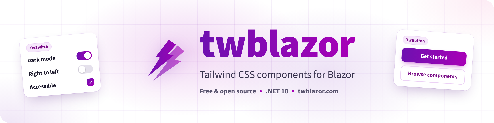
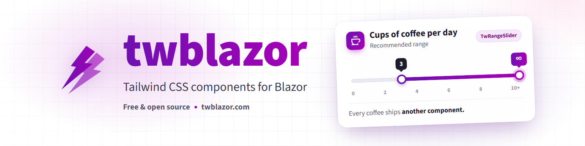

<p align="center">
  <a href="https://twblazor.com/" target="_blank">
    
  </a>
</p>
<p align="center">

[](https://sonarcloud.io/summary/new_code?id=twblazor_twblazor)
[](https://sonarcloud.io/summary/new_code?id=twblazor_twblazor)
[](https://sonarcloud.io/summary/new_code?id=twblazor_twblazor)
[](https://sonarcloud.io/summary/new_code?id=twblazor_twblazor)
[](https://sonarcloud.io/summary/new_code?id=twblazor_twblazor)
[](https://sonarcloud.io/summary/new_code?id=twblazor_twblazor)
[](https://sonarcloud.io/summary/new_code?id=twblazor_twblazor)
[](https://sonarcloud.io/summary/new_code?id=twblazor_twblazor)
[](https://github.com/TwBlazor/twblazor/blob/develop/LICENSE.txt)
[](https://github.com/TwBlazor/twblazor/stargazers)
[](https://github.com/TwBlazor/twblazor/graphs/contributors)
[](https://github.com/TwBlazor/twblazor/discussions)
[](https://www.nuget.org/packages/twblazor)
[](https://www.nuget.org/packages/twblazor)

</p>


<p align="center">
    <a href="https://twblazor.github.io/twblazor/" target="_blank">API Documentation (docfx)</a> &bullet; <a href="https://twblazor.com/" target="_blank">Component Documentation (twblazor.com)</a> &bullet; <a href="https://twblazor.com/get-started" target="_blank">Get Started</a> &bullet; <a href="https://twblazor.com/ai-agents" target="_blank">AI Agents &amp; Skills</a> &bullet; <a href="https://buymeacoffee.com/twblazor" target="_blank">Support development 💜</a>
</p>

## Contents

- [Why twblazor?](#why-twblazor)
- [Setup](#setup)
- [Class merging](#class-merging)
- [Localization](#localization)
- [AI agent skills](#ai-agent-skills)
- [Supported .NET versions](#supported-net-versions)
- [Dependencies](#dependencies)

## Why twblazor?

- Every component is styled with plain Tailwind CSS classes, so there is no built-in CSS to fight when you want something to look different.
- All styles live in one typed theme file. Change a color, spacing or radius there without digging through component internals.
- See your changes straight away with Tailwind and hot reload.
- Built-in class merging: a `Class` you pass to a component replaces the theme's conflicting utility instead of both reaching the element.
- Accessibility comes first, with ARIA attributes and keyboard navigation built into the components.
- Open source under the MIT license, free for personal and commercial projects.
- Actively maintained, with new components, accessibility fixes and documentation landing regularly.
- Contributions, issues and feedback are welcome from everyone using it.

Using twblazor in your own project? Share it [here](https://github.com/TwBlazor/twblazor/discussions/81). We would love to see what you're building!

## Setup

The fastest way to start is the project template. Install the [twblazor.templates](https://www.nuget.org/packages/twblazor.templates) .NET tool once (update it later with `dotnet tool update -g twblazor.templates`):

```pwsh
dotnet tool install -g twblazor.templates
```

Then create a complete app. The command creates the solution, pages, layout, theme and Tailwind build, restores the packages and prints how to run it. Every option is optional:

```pwsh
twblazor new MyApp -i auto -t sidebar -f net11.0
```

| Option | Values | Default |
| --- | --- | --- |
| `-i`, `--interactivity` | `server`, `wasm`, `auto` | `server` |
| `-t`, `--template` | `dashboard`, `sidebar`, `navbar`, `blank` | `dashboard` |
| `-f`, `--framework` | `net11.0`, `net10.0` | `net11.0` |
| `-o`, `--output` | Folder to create the app in | `./MyApp` |
| `--tailwind` | `cli` (through `npx`) or `npm` | Asks, or `cli` when not interactive |
| `--no-restore` | Skip `dotnet restore` | |
| `--no-npm` | Skip the Tailwind CSS build | |
| `--force` | Write into a folder that is not empty | |

`-f` needs twblazor.templates 3.6.0 or later. `twblazor new` is the only command you need after the tool is installed. If you are adding twblazor to an existing app instead, install the [twblazor NuGet package](https://www.nuget.org/packages/twblazor) and follow the [Get Started guide](https://twblazor.com/get-started) for stylesheets, imports, providers, theming and dependency injection:

```pwsh
dotnet add package twblazor --version 3.7.0
```

## Class merging

A `Class` you pass to a component replaces the theme's conflicting Tailwind utility, so `Class="px-2"` wins over the theme's `px-4`. It is built in and needs no setup. See the [Class Merge docs](https://twblazor.com/class-merge) for the rules and how to turn it off or teach it your own utilities.

## Localization

Component text and date and time formats follow `CultureInfo.CurrentUICulture`. English and 23 more languages ship with the package, and right to left cultures mirror every component. See [LOCALIZATION.md](LOCALIZATION.md) for the languages, changing the wording and right to left layouts, or the [Localization docs](https://twblazor.com/localization) for every key and option.

## AI agent skills

Using Claude Code or another AI coding agent? twblazor publishes skills that teach it to set up, theme, localize and build with the real components and parameters. See [AI-AGENTS.md](AI-AGENTS.md) to install them, or [AI Agents & Skills](https://twblazor.com/ai-agents) on the docs site.

## Supported .NET versions

| twblazor          | .NET 11 | .NET 10 |
| ----------------- | ------- | ------- |
| 3.7.0 and later   | ✅      | ✅     |
| 3.6.x and earlier | ➖      | ✅     |

From 3.7.0 the package is built for both .NET 11 and .NET 10, so it installs into either without any extra setup. Upgrade to 3.7.0 or later before moving an app to .NET 11. See [SECURITY.md](SECURITY.md) for which release lines receive security fixes.

## Dependencies 

- [Tailwind CSS](https://tailwindcss.com/) - A utility-first CSS framework for styling components.
- [Bootstrap Icons](https://icons.getbootstrap.com/) - An open-source icon library used for our TwIcon component.

<br>

---

<br>

<p align="center">
  <a href="https://buymeacoffee.com/twblazor" target="_blank">
    
  </a>
</p>

<p align="center">
  This library is powered by Tailwind, Blazor and a dangerous amount of coffee.<br>
  You can help with that last one at <a href="https://buymeacoffee.com/twblazor" target="_blank"><strong>buymeacoffee.com/twblazor</strong></a>. Thank you! ☕
</p>
